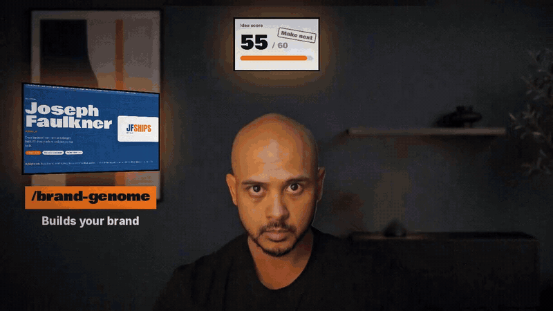
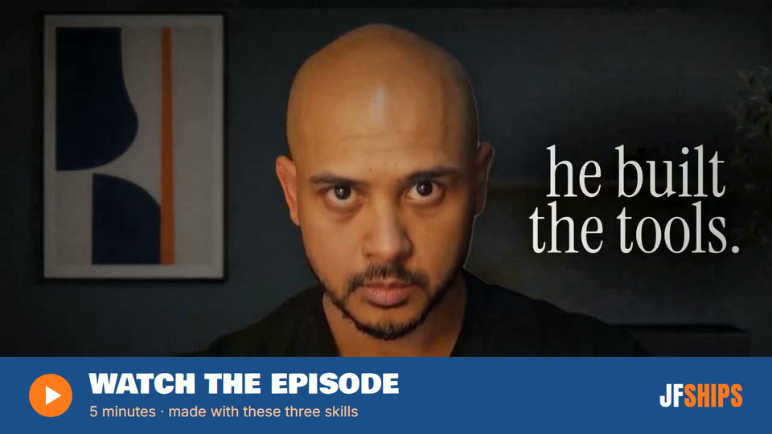
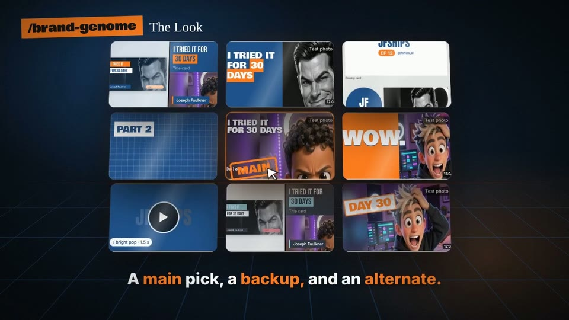
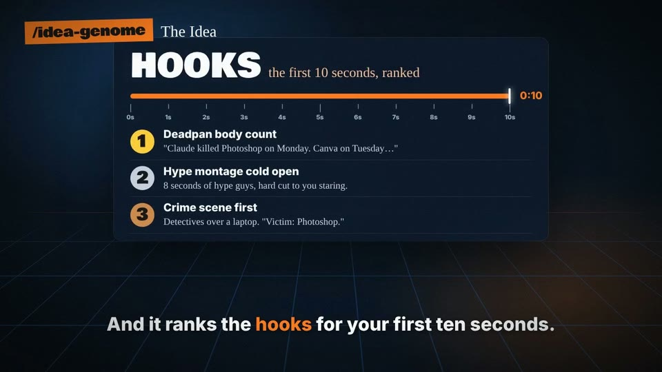
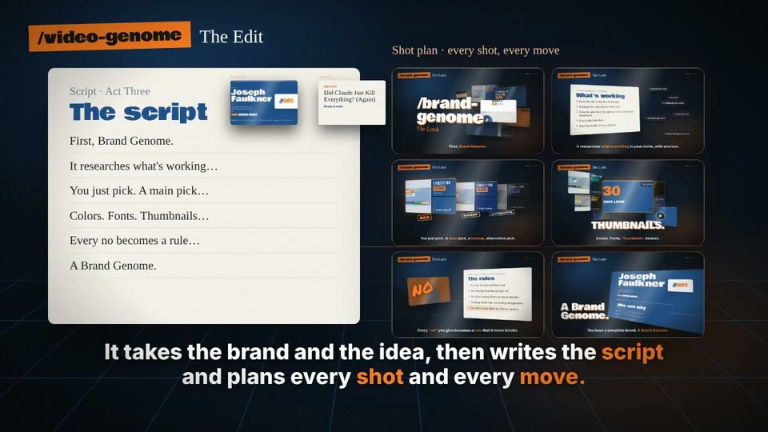

# content-genome

[](../../releases/latest)
[](LICENSE)
[](https://support.claude.com/en/articles/12512198-how-to-create-custom-skills)

Four free Claude skills that take you from "I should start posting" to a finished, on-brand video. My channel's first episode was made with them.

[][episode]

## Install

**Claude (web, desktop, mobile)**

1. Download a skill: [brand-genome.zip](../../releases/latest/download/brand-genome.zip) · [idea-genome.zip](../../releases/latest/download/idea-genome.zip) · [script-genome.zip](../../releases/latest/download/script-genome.zip) · [video-genome.zip](../../releases/latest/download/video-genome.zip)
2. In Claude, go to **Customize → Skills**, click **+**, then **Create skill → Upload a skill**, and pick the zip.
3. Make sure code execution is on (**Settings → Capabilities**).

**Claude Code**

```bash
git clone https://github.com/jfships/content-genome.git
mkdir -p ~/.claude/skills
cp -r content-genome/skills/* ~/.claude/skills/
```

Then ask for what you want, e.g. "build my brand genome", "give me a video idea", "make this into a video".

**For best results:** run idea-genome, video-genome's planning and first draft, and brand-genome when you let it decide for you (auto or demo), on your strongest model (today: Fable). That's where the creative calls are made. Then switch to your everyday model (today: Opus) for fixes, renders and checks, which costs less. The skills remind you when to switch.

## Watch it

AI didn't kill everything. I made this episode with tools I built myself, and these are the tools.

[][episode]

## The four skills

They hand off to each other: **brand-genome** (once per brand) → **idea-genome** (per video) → **script-genome** (per video) → **video-genome** (per video). Each one also works on its own. video-genome runs without a Brand Genome, using a brand kit you already have or one of the kits it ships with.

### [brand-genome](skills/brand-genome)



Builds your whole content brand by picking from visuals instead of describing: identity, formats, look, movement, sound, brand kit, vertical system, voice, profiles. Every "no" you give becomes a rule it never breaks. Works for a real creator or a made-up demo one.

**You end up with:** `Brand Genome.md` plus your brand kit.

### [idea-genome](skills/idea-genome)



Turns a theme, a hunch or nothing at all into a scored video idea, with an angle, three titles with their own thumbnails, and ranked hooks for the first ten seconds. Shorts get their own path: one idea per Short, a shape built for 30 seconds, and a check that a stranger gets it without the long video.

**You end up with:** an Idea Record per video.

### [script-genome](skills/script-genome)

Turns your raw words (notes, a voice memo, a transcript) into a short-video script, beat by beat: the hook on three layers, a shape or story arc picked for your idea, what keeps people watching, the ending, and what the screen and sound do on each line. It also checks a finished script: legal, platform, accuracy and clarity first, craft as notes, never a score. Every option comes with how it works and how well it's backed; nothing is treated as a rule. Reels and Shorts now; long-form scripts next.

**You end up with:** a script card per video, or a check report.

### [video-genome](skills/video-genome)



Takes the brand, the idea and the script card, and plans every shot. Then it builds and checks the video: long episodes, plus Shorts, Reels and TikToks on their own track (written and built tall, never a crop of the long edit), with motion graphics, sound, thumbnails, titles and upload copy.

**You end up with:** finished video files and a results log.

## What they need

- **Required:** Claude with code execution (a shell with Python 3).
- **video-genome** builds with [HyperFrames](https://github.com/heygen-com/hyperframes) (needs Node). It fetches it fresh each run.
- **Optional:** image, video, music and voice tools (e.g. Higgsfield, Black Forest Labs, ElevenLabs). Without them, the skills draw in code and use the test photos they ship with.
- Any API keys go in a local `.env` file. Never commit it.

## Need one built for your business?

If you want a tool like these made for your own business, reach out through [YouTube](https://youtube.com/@jfships_ai) or [X](https://x.com/jfships_ai).

## License

[MIT](LICENSE). The benchmark photos in `skills/brand-genome/benchmark` are AI-generated test frames that ship with the skill. The Geist fonts in video-genome are under the SIL Open Font License (see `OFL-Geist.txt`). Images in `media/` are stills from the episode.

[episode]: https://youtu.be/sevoOfx7Dno
